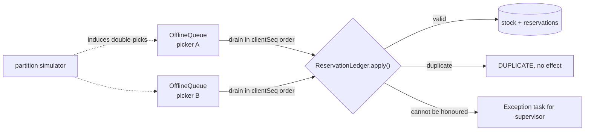

# pickpath

An offline-first warehouse picking sync core where conflicting picks become supervisor exceptions instead of silently lost picks.

[](https://github.com/SlateGitOrg/pickpath/actions/workflows/ci.yml)
[Live workbench](https://slategitorg.github.io/pickpath/)

## Why

Warehouse aisles are Wi-Fi dead zones. Pickers scan items offline for twenty minutes and then reconnect. If two pickers both claimed the last unit of an SKU, naive sync silently overwrites one of them, producing a short ship that the customer discovers instead of the warehouse. The loss does not show up in any warehouse metric until a chargeback arrives. pickpath resolves the conflict explicitly and counts the outcome.

## Features

- Reservation ledger as the sole authority on stock: sync validates offline actions rather than merging them.
- Exception tasks for unresolvable conflicts, carrying the SKU, picker, reason, requested and available quantities, and the other pickers holding that SKU.
- Idempotent apply keyed by `(pickerId, clientSeq)`, so replaying a queue is safe.
- Durable-order offline queue with a monotonic client sequence, drained in order.
- Deterministic, seeded partition simulator that induces known double-picks, so "silent losses" is a measured count.
- A last-write-wins baseline for side-by-side comparison.
- A static browser workbench (`site/`) published to GitHub Pages.

## Architecture



Each picker's offline actions go into an `OfflineQueue`. On reconnect the queue drains in client order into the `ReservationLedger`, which applies the action, recognises a duplicate, or records an exception task. Conflict resolution is a reservation check with escalation to a human, not last-write-wins and not a CRDT merge. More detail in [docs/ARCHITECTURE.md](docs/ARCHITECTURE.md).

## Quick start

Requires Node 22.18+ (24 recommended). TypeScript runs through Node's built-in type stripping, so there is no build step and no `node_modules`.

```bash
git clone https://github.com/SlateGitOrg/pickpath.git
cd pickpath
npm test        # unit tests and simulator
npm run demo    # 500 contested SKUs, two strategies
```

## Example

`npm run demo` output:

```text
  strategy                  applied  exceptions  SILENT LOSSES  stock < 0
  --------------------------------------------------------------------------
  reservation ledger        500      500         0              no
  last-write-wins           500      0           500            no

  The queue was replayed twice (an unreliable reconnect):
  1000 duplicate submissions recognised, outcome unchanged.

  What the supervisor receives, on reconnect:
    SKU SKU-4471  picker=bob  reason=INSUFFICIENT_STOCK
      requested 1, available 0, conflicts with: alice
```

## How it works

- **Reservations** are issued when a pick list is assigned and are allowed to oversell, because real counts are slightly wrong and the conflict is the case being handled.
- **`apply()`** returns `DUPLICATE` for a seen action key; otherwise it raises an exception for `NO_RESERVATION`, `RESERVATION_EXCEEDED` or `INSUFFICIENT_STOCK`, and only then decrements stock.
- **Exceptions count as decided**, so a retried action does not create a second task.
- **The simulator** gives every SKU one unit and two reservations, shuffles reconnect order, optionally replays each queue twice, and checks that every submitted action was either applied or excepted.

## Testing

```bash
npm test
```

`tests/conflict.test.ts` covers: 500 induced double-picks yield zero silent losses and exactly one exception each; stock never goes negative; replaying the queue twice changes nothing; results are deterministic per seed; last-write-wins loses one pick per conflict; exception context; and queue ordering. `site/core.test.mjs` covers the workbench computation. CI also runs `scripts/validate_site.py`.

## Project layout

```text
src/sync.ts         OfflineQueue and ReservationLedger
src/partition.ts    seeded partition simulator and last-write-wins baseline
src/demo.ts         the demo above
tests/              conflict and ordering tests
site/               static workbench (GitHub Pages)
docs/               architecture notes and screenshots
```

## Limitations

State is in memory: there is no database, network transport, PWA shell or pick-path routing. The simulator and the workbench model the sync-correctness problem, not a full warehouse management system.

## License

MIT — see [LICENSE](LICENSE).
