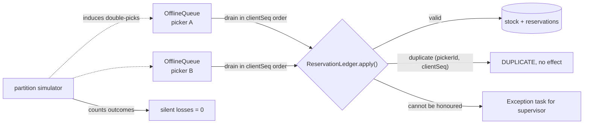

# Architecture

## Context

Warehouse aisles are Wi-Fi dead zones, so pick scanners queue their actions
offline and replay them on reconnect. When two pickers were both assigned the
last unit of an SKU, the sync layer has to decide what happens to the second
pick. PickPath models that decision and makes the outcome measurable.

## Components

- `src/sync.ts` holds `OfflineQueue` (monotonic per-picker sequence numbers,
  drained in order) and `ReservationLedger` (stock, reservations, applied-action
  set, exception list).
- `src/partition.ts` is a deterministic, seeded simulator that creates contested
  SKUs, replays queues in shuffled order (optionally twice) and counts outcomes.
- `site/` is a static browser workbench over the same reconciliation idea,
  published to GitHub Pages.

## Key decisions

**Validate, don't merge.** The ledger checks each offline action against the
reservation issued when the pick list was assigned. An action that has no
reservation, exceeds its reservation, or asks for more than the remaining stock
becomes an exception task naming the other pickers holding that SKU.
- Last-write-wins was rejected: it discards one pick with no trace.
- A CRDT merge was rejected: it converges, but on a value that can violate the
  invariant that stock cannot go below zero. CRDTs suit concurrent edits that
  are all legal; here one of them is not.

**Reservations may oversell.** Pick lists are assigned from a stock count that
is already slightly off, so `reserve()` does not refuse. Removing the conflict
by construction would hide the case the system exists to handle.

**Idempotency by action key.** Each action is keyed by `(pickerId, clientSeq)`.
Replaying a queue after an unreliable reconnect returns `DUPLICATE` and changes
nothing. Exceptions also count as decided, so a retry does not create a second
task.

**Ordering is a guarantee.** `OfflineQueue.drain()` sorts by `clientSeq`, so
actions apply in the order taken on the device regardless of arrival order.

## Failure modes

- Unreserved or over-reserved picks: exception, never a silent accept.
- Replayed queue: `DUPLICATE`, outcome unchanged.
- Contested last unit: one pick applies, the other raises an exception with
  requested and available quantities.

## Out of scope

No persistence (state is in memory), no network transport, no PWA shell or
service worker, and no pick-path routing. The ledger and simulator model the
sync-correctness problem only.
